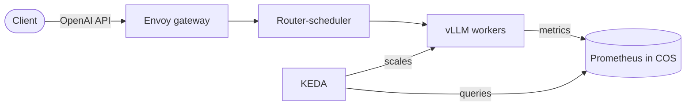

# KServe operators

[](https://github.com/canonical/kserve-operators/actions/workflows/on_pull_request.yaml)
[](https://github.com/canonical/kserve-operators/actions/workflows/release.yaml)

Juju charms that deploy [KServe](https://kserve.github.io/website/) on Kubernetes. They
serve two purposes:

- **Charmed llm-d**: serve and autoscale open-weight large language models with
  [vLLM](https://docs.vllm.ai/) and the [llm-d](https://llm-d.ai/) inference scheduler,
  behind an [Envoy Gateway](https://gateway.envoyproxy.io/), on CPUs or NVIDIA GPUs,
  with [KEDA](https://keda.sh/) autoscaling and the
  [Canonical Observability Stack](https://documentation.ubuntu.com/observability/).
- **Classic model serving**: KServe `InferenceService` workloads, as part of
  [Charmed Kubeflow](https://canonical.com/mlops/kubeflow).

## Charms

| Charm | Charmhub | Description |
| --- | --- | --- |
| [`kserve-controller`](charms/kserve-controller) | [](https://charmhub.io/kserve-controller) | KServe control plane, in standard or Knative mode. |
| [`kserve-llmisvc`](charms/kserve-llmisvc) | [](https://charmhub.io/kserve-llmisvc) | Controller for `LLMInferenceService`, with vLLM metrics, alerts and dashboards. |
| [`llm-integrator`](charms/llm-integrator) | [](https://charmhub.io/llm-integrator) | Serves one LLM from Juju configuration, optionally autoscaled. |
| [`keda-controller`](charms/keda-controller) | [](https://charmhub.io/keda-controller) | KEDA, the event-driven autoscaler. |

The stack also uses [`lws-controller`](https://github.com/canonical/lws-controller-operator),
the LeaderWorkerSet controller, which lives in its own repository.

## Charmed llm-d



`kserve-controller` and `kserve-llmisvc` run the KServe control plane. Each model is an
`llm-integrator` application that renders a KServe `LLMInferenceService` from a few
configuration options: a Hugging Face or S3 model URI, CPU or GPU, and the replica
range. KServe turns it into vLLM workers and a route on the Envoy gateway, and KEDA
scales them on live vLLM metrics.

### Quick start

The [autoscaling-model-serving](https://github.com/canonical/autoscaling-model-serving)
Terraform solution deploys the whole stack, and COS, into an existing Juju controller:

```bash
git clone https://github.com/canonical/autoscaling-model-serving.git
cd autoscaling-model-serving && git checkout track/0.3
cd terraform/deployments/llm-cos
terraform init && terraform apply
```

Then serve a model and query it:

```bash
juju deploy -m kserve-llm llm-integrator pythia --channel latest/edge --trust \
  --config model-uri=hf://EleutherAI/pythia-70m
juju integrate -m kserve-llm pythia:kserve-llmisvc kserve-llmisvc:kserve-llmisvc

GW=$(kubectl get gateway -n kserve-llm envoy-ingress-k8s -o jsonpath='{.status.addresses[0].value}')
curl "http://$GW/kserve-llm/pythia/v1/completions" -H 'Content-Type: application/json' \
  -d '{"model": "EleutherAI/pythia-70m", "prompt": "Kubernetes is", "max_tokens": 30}'
```

The [documentation](docs) covers preparing a GPU machine, connecting COS, GPU models,
gated models, S3 models and autoscaling. To build and preview it locally, run
`make run` in the `docs` directory.

## Classic model serving

`kserve-controller` also runs KServe for `InferenceService` workloads, in one of two
modes set by its `deployment-mode` option:

- `knative`, the default: serverless serving with scale to zero, behind an Istio
  sidecar gateway and Knative Serving.
- `rawdeployment`: plain Kubernetes Deployments (RawDeployment), without Knative.

It is deployed as part of [Charmed Kubeflow](https://canonical.com/mlops/kubeflow). To
deploy KServe alone, use the `kserve` product of the
[autoscaling-model-serving](https://github.com/canonical/autoscaling-model-serving)
Terraform solution, which wires Istio and, in Knative mode, Knative Serving.

### Custom images

`kserve-controller` comes with a set of images used by KServe workloads, listed in
[`default-custom-images.json`](charms/kserve-controller/src/default-custom-images.json).
Override any of them with the `custom_images` option, in YAML or JSON. Images you do
not set keep their defaults:

```bash
juju config kserve-controller custom_images='{"configmap__agent": "custom:1.0", "serving_runtimes__lgbserver": "custom:2.1"}'
```

`kserve-llmisvc` has the same `custom_images` option for its images, and `llm-integrator`
has `runtime-image` and `storage-initializer-image`.

## Development

The repository holds one directory per charm under [`charms`](charms), shared
integration tests under [`tests/integration`](tests/integration), and the documentation
under [`docs`](docs). `tox` is the only tool you need; it installs the rest.

```bash
tox -e controller-lint                 # lint the charm
tox -e controller-unit                # unit-test the charm
tox -e controller-integration -- --model kubeflow   # integration tests
```

Each charm's `tox.ini` also has a `fmt` environment, for example
`tox -c charms/llm-integrator -e fmt`. See [`CONTRIBUTING.md`](CONTRIBUTING.md) for
managing dependencies and upgrading the upstream KServe version.

## Contributing

Canonical welcomes contributions. Please read the
[contributor licence agreement](https://canonical.com/legal/contributors) and
[`CONTRIBUTING.md`](CONTRIBUTING.md) before opening a pull request.

Report bugs and request features in
[GitHub issues](https://github.com/canonical/kserve-operators/issues).

## Security

Please do not report security issues in GitHub issues. Report them through
[Launchpad](https://wiki.ubuntu.com/DebuggingSecurity) instead.

## License

The charms are distributed under the Apache License 2.0; see the `LICENSE` file in each
charm's directory.
